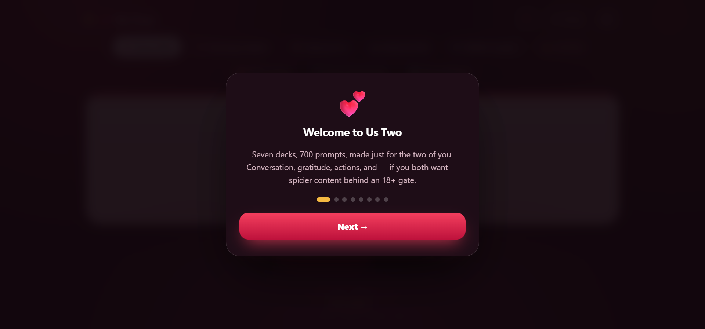
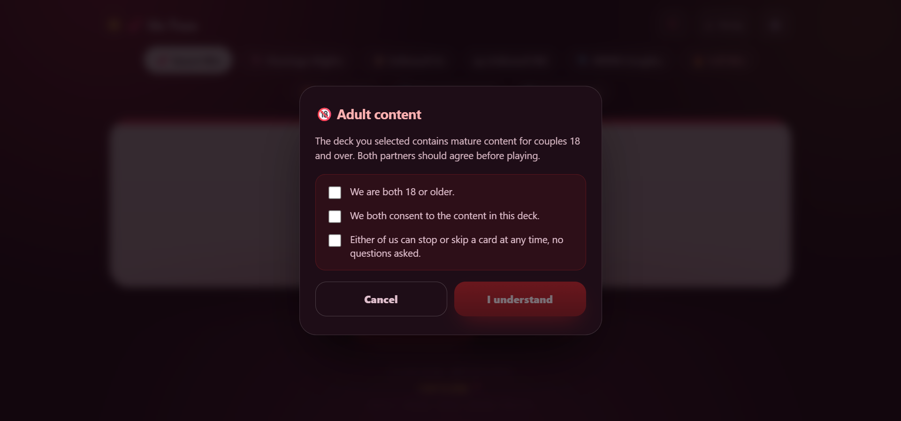

# 💕 Us Two

  

  <strong>A single-file, offline-capable card game for couples.</strong> 
  Conversation, connection, and intimate play. Works on one device or synced across two.

Built as one HTML file with zero build steps, zero backend, and zero accounts. Drop it on any static host, share the link, and play.

> Looking for the party/friends version? That lives [here](https://github.com/MmedaraU/party-games) with its own README.

---

## Features

- **853 prompts** across six decks — three sweet decks for deep connection, and three 18+ decks for spicier nights.
- **Before We Leap** — a dedicated 100-prompt deck built on Christian premarital counseling and Esther Perel’s frameworks to tackle marriage, parenting, and family boundaries.
- **Sweet Mix and Spicy Mix** — one safe shuffle for cozy nights, and one that strictly pulls from the 18+ decks. 
- **Consent gate for adult content** — a three-checkbox agreement appears before any mature deck, remembered for 24 hours and clearable anytime. In Party Mode, each device confirms independently.
- **Sensory & Roleplay Dares** — 272 action cards covering kissing, touch, movement, taste, sound, and power dynamics.
- **Scoring deck** — Never Have I Ever lets both partners vote on their own device, then reveals the tally with live score updates.
- **Real-time Party Mode** — one host, unlimited guests, everyone sees the same card. Guests dedup on rejoin via a persistent client ID.
- **Dark mode** — Light, Dark, and System themes, saved per device, with no flash of light content on load.
- **Fully responsive** — works beautifully on phones, tablets, laptops, and long-distance video calls.

---

## Quick Start

### On one device
1. Download `us-two.html` (or copy the code into a file with that name).
2. Double-click it to open in any modern browser.
3. Pick a deck, tap **Next Card**, and read the prompt aloud.

### Long-distance or two devices
1. Open the file on one device and tap **🎉 Party → Host a Party**.
2. Share the 4-character code, link, or QR code with your partner.
3. They open the link or join by typing the code. Both screens will stay in perfect sync.

*Party Mode requires internet access for the initial WebRTC peer connection. Solo mode works fully offline.*

---

## How to Play

- **Next Card:** Tap the button, swipe left, or press `Space / → / Enter`.
- **Action Cards:** Tap **💕 LET'S DO IT** or **⏭️ SKIP FOR NOW** (press `1` or `2`). Skipping is always free and has no penalty.
- **Scoring Cards (NHIE):** Both partners vote **✋ I HAVE** or **🙅 I HAVEN'T**. When both votes are in, the host taps **👁️ Reveal Answers** to drop scores.
- **The Guide:** A 9-step interactive guide appears on first open. You can reopen it anytime with the **❓** button in the header.

---

## The Decks

| Deck              | Emoji | Count   | Style                                                    | Adult   |
| ----------------- | ----- | ------- | -------------------------------------------------------- | ------- |
| Deep Talk         | 💗     | **54**  | Deep questions on perception, connection, and reflection | No      |
| Unboxed Us        | 📦     | **259** | Conversation, conflict resolution, love languages        | No      |
| Before We Leap    | 💍     | **100** | Premarital & parenting questions (Christian & Perel)     | No      |
| Dares             | 🎭     | **272** | Intimate prompts — kissing, sensory play, roleplay       | **18+** |
| Drunk Desire      | 🥃     | **83**  | Drinking-game prompts                                    | **18+** |
| Never Have I Ever | 💬     | **85**  | Couple confessions with finger scoring                   | **18+** |
| **Sweet Mix**     | 💕     | **413** | The three sweet decks shuffled together                  | No      |
| **Spicy Mix**     | 🔥     | **440** | The three 18+ decks shuffled together                    | **18+** |

*(Note: The former "Unboxed NG" deck has been merged into "Unboxed Us", giving it a combined 259 prompts.)*

---

## Safety & Consent

  

The three 18+ decks are gated behind a three-checkbox consent modal (Age, Consent, Right to Stop). 

- **Consent is continuous.** Ticking the gate is the start of consent, not the end. Either partner can stop, pause, or skip at any time.
- **Skip is always free.** Skipping has no counter, no record, and no penalty.
- **Drunk Desire is a drinking game.** Know your limits, hydrate, and never pressure your partner to drink. 
- **Privacy:** Everything runs in the browser. Party Mode is peer-to-peer; the only data leaving your device is the current card, counters, and votes.

---

## Technical Stack & Customization

- **Stack:** HTML, CSS, Vanilla JavaScript. No frameworks, no build steps.
- **Sync:** WebRTC via [PeerJS](https://peerjs.com/). 
- **Audio/Visuals:** Canvas 2D (confetti) and Web Audio API (synthesized sounds).
- **Storage:** LocalStorage is used to remember your theme, sound preference, and 18+ consent (expires after 24 hours).

### Customizing the Game
All content is managed in three objects near the top of the `<script>` tag in `index.html`:
- `RAW`: The actual prompt arrays. Add strings for plain cards, or `{ text: "...", kind: "action" }` for action cards.
- `RAW_SOURCES`: Maps your deck keys to one or more prompt arrays (allowing you to merge decks).
- `DECKS`: Defines the deck labels, emojis, colors, and whether they are `adult` or `scoring`.
- `FILTERS`: Defines what appears in the game selection menu and maps the Sweet/Spicy mixes.
- `CONSENT_TTL_MS`: Change this value to adjust how long the 18+ consent lasts before timing out.

The code is heavily commented to show you exactly how to add new prompts, change deck colors, or adjust the consent timer.

---

## Deployment

Everything lives in a single HTML file. Host it anywhere static. **HTTPS is required for Party Mode** (WebRTC).

- **GitHub Pages:** Commit the file, go to Settings → Pages, and select your branch.
- **Netlify:** Drag the folder onto [app.netlify.com/drop](https://app.netlify.com/drop).
- **Vercel:** Run `vercel --prod` in the directory.

To test locally, run `python3 -m http.server 8080` and visit `http://localhost:8080`.

---

## Troubleshooting

**Guests can't connect**
- Confirm both devices are online and the site is served over HTTPS.
- Some corporate or public Wi-Fi blocks WebRTC — try a mobile hotspot.

**Never Have I Ever reveal won't enable**
- Every voter must vote first. In Party Mode, watch the "X of Y voted" counter.
- If a partner walks away without voting, tap **⏭️ Skip this card** to move on without scoring anyone.

**Sound doesn't play**
- Browsers block audio until the first user interaction. Tap once, then draw.

---

## Browser Support

| Browser                           | Solo | Party Mode | 18+ Gate | Dark Mode |
| --------------------------------- | ---- | ---------- | -------- | --------- |
| Chrome / Edge (desktop + Android) | ✅    | ✅          | ✅        | ✅         |
| Safari (macOS + iOS)              | ✅    | ✅          | ✅        | ✅         |
| Firefox                           | ✅    | ✅          | ✅        | ✅         |
| Samsung Internet                  | ✅    | ✅          | ✅        | ✅         |

---

## License

Free to use, modify, and share for personal use between consenting adults.

All prompt content is original and written for this project. The 18+ decks are intended for consensual adult play only. Neither the app nor its authors are responsible for how the prompts are used. **Play responsibly.**

  Enjoy each other. 💕

